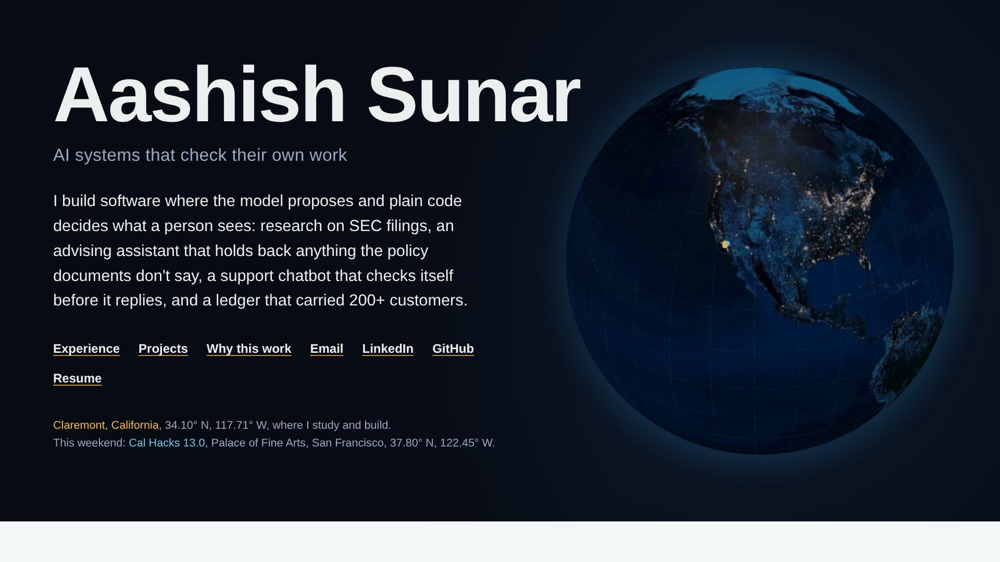

# Aashish Sunar

Software engineer in Claremont, California. MS in AI-Driven Innovation at Claremont Graduate University (May 2027), BA in Economics and Finance from Soka University of America.

I build AI systems that check their own work before anyone relies on them. The model proposes and plain code decides: a quote from an SEC filing is verified before it ships, an advising answer the policy documents don't support goes to a human advisor, and a payment that arrives twice is recorded once.

**[See my portfolio →](https://aashisho1o1.github.io/Aashisho1o1/)** &nbsp;·&nbsp; **[Resume (PDF)](docs/Aashish_Sunar_Resume.pdf)** &nbsp;·&nbsp; This weekend: at Cal Hacks 13.0 in San Francisco

---

### Selected work

| Project | What it does | The check that matters |
| :-- | :-- | :-- |
| [**RipplX**](https://github.com/Aashisho1o1/RipplX) | Reads a company's SEC filings against the prior period and writes a short brief of what changed. ([live site](https://rippl-x-nine.vercel.app)) | Every quote is verified at its exact filing, section, and offset, and every number against XBRL. The model never does arithmetic. |
| [**Traume**](https://github.com/Aashisho1o1/Trauma-Informed-Chatbot) | Trauma-informed support chatbot prototype. | Crisis checks run before the model is called, output is filtered after, and an adversarial test suite fails the build below threshold. |
| [**OwenWrites**](https://github.com/Aashisho1o1/Owen) | Helps novelists keep each character's voice consistent across a manuscript. | Answers about a character come from the writer's own pages through vector search, not the model's guess. |
| [**BlueHabit**](https://devpost.com/software/bluehabit) | Route planner for wheelchair users and people with vision loss. Fourth of 30+ teams at the CGU Ethical AI Hackathon. | Combines air quality and satellite data, because the shortest route is often the wrong one for someone in a wheelchair. |
| [**Alumni Disaster Tracker**](https://github.com/Aashisho1o1/ADT) | Matches NASA's live disaster feed against 2,000+ alumni locations. ([demo](https://8gkea33ouexurck54ybeah.streamlit.app/)) | One NumPy operation checks every alumni and event distance, about 10 ms for 2,000 people. |

### Work

- **Claremont Graduate University**, Software Developer. Built the academic advising assistant: 500+ questions handled, roughly 40 percent fewer reach a human advisor, and anything the policy documents don't cover is held back for an advisor.
- **AI for Humanity Lab, CGU**, Software Engineer and AI Research Fellow. Built a Playwright tool that checks whether EU AI Act disclosure notices can actually be seen, not just found in the page code. Leading the organization of the CGU Transdisciplinary AI Hackathon (November 13 and 14, 2026).
- **Nepal Technical Service**, Full Stack Engineer and Co-Founder. Sales, inventory, and accounting platform for retail shops in Nepal, with a double-entry ledger where each sale is recorded exactly once.
- **Soka University of America**, Full Stack Developer. Real-time disaster alerts on NASA EONET for 2,000+ alumni.

### Tools I use

Python, TypeScript, Java, SQL · FastAPI, React, Next.js, Node.js · PostgreSQL, SQLite, Redis · Anthropic, OpenAI, and Gemini APIs, RAG · AWS, Docker, GitHub Actions, Playwright

### Contact

aashishsunar.01@gmail.com · [LinkedIn](https://www.linkedin.com/in/aashish-sunar/) · Available for full-time or part-time roles from December 2026.
